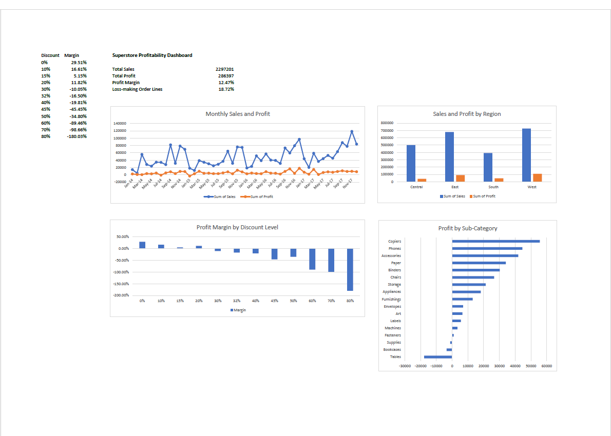

# Superstore Profitability Analysis (Excel)

Excel analysis of 9,994 order lines from a retail Superstore dataset: where the business makes money, where it loses it, and how discounts relate to profit.

## Business questions

- What are total sales, profit and profit margin?
- Which categories and sub-categories make or lose money?
- Do higher discounts go with lower profit?
- How do regions, segments and months compare?

## Data

Superstore Sales dataset from Kaggle (CC0), 9,994 rows, 21 columns. No currency is stated in the data. The file is one row per order line, so Order IDs repeat.

## Tools

Excel for the web: tables, formulas, PivotTables, charts

## Data checks and cleaning

- 9,994 rows, no duplicate Row IDs, no blank cells
- Raw data kept in a separate tab; all work done in a copy
- Added columns: Profit Margin, Order Month, Order Year
- Totals: sales 2,297,201; profit 286,397 (12.47% margin)

## Key findings

1. 1,871 of 9,994 order lines (18.7%) lose money, even though overall margin is 12.47%.
2. Furniture makes about 32% of sales but only about 6% of profit (2.5% margin). Tables (-17.7K), Bookcases (-3.5K) and Supplies (-1.2K) lose money.
3. Profit is positive up to 20% discounts and negative at every level from 30% up. The 1,393 lines at 30% or more lose about 135K combined.
4. Discounts explain some losses but not all: Tables and Bookcases have above-average discounts (26% and 21%), but Supplies loses money with a low average discount (7.7%), and Binders earns 30K despite the highest average discount (37%).
5. Central is the weakest region (7.92% margin) and West the strongest (14.94%).
6. Sales grew over the four years, but profit grew much less.

## Limitations

These are associations, not proof of cause. Averages of discount per sub-category hide the spread within each product, and small discount groups (10%, 15%, 32%, 45%) have few rows.

## Recommendations

1. Review discount rules: avoid discounts of 30% or more unless a margin check is done.
2. Review pricing and costs for Tables, Bookcases and Supplies.
3. Investigate why the Central region earns a lower margin.

## Files

- `dashboard/`: dashboard screenshot and the Excel workbook (PivotTables, charts, checks)
